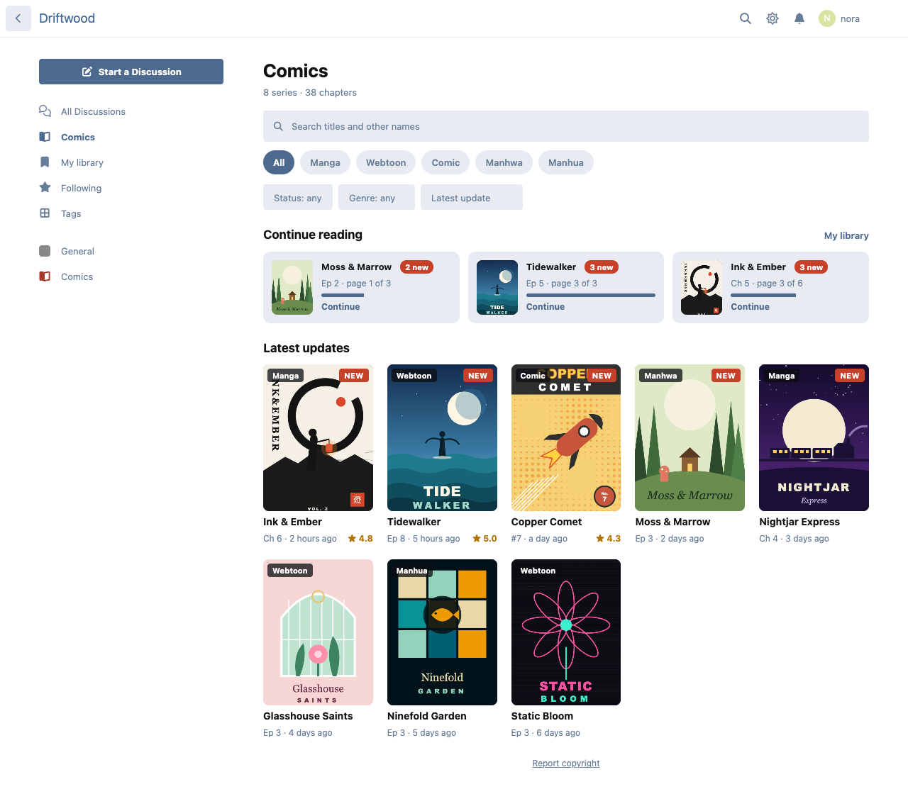
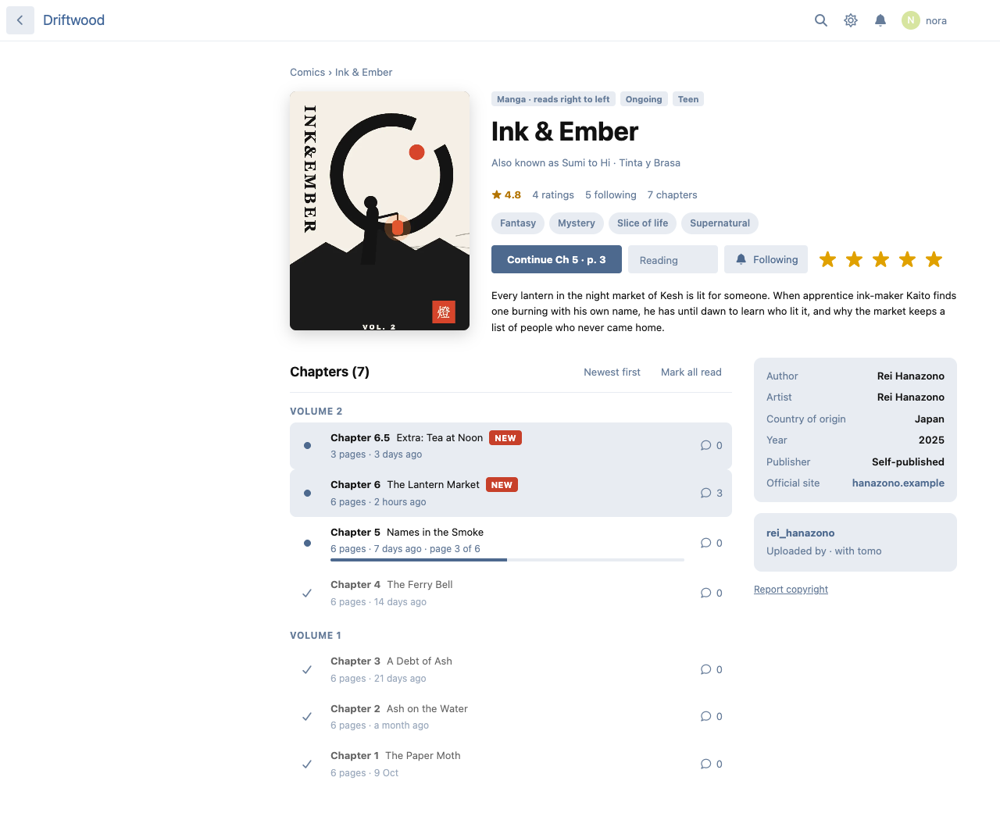
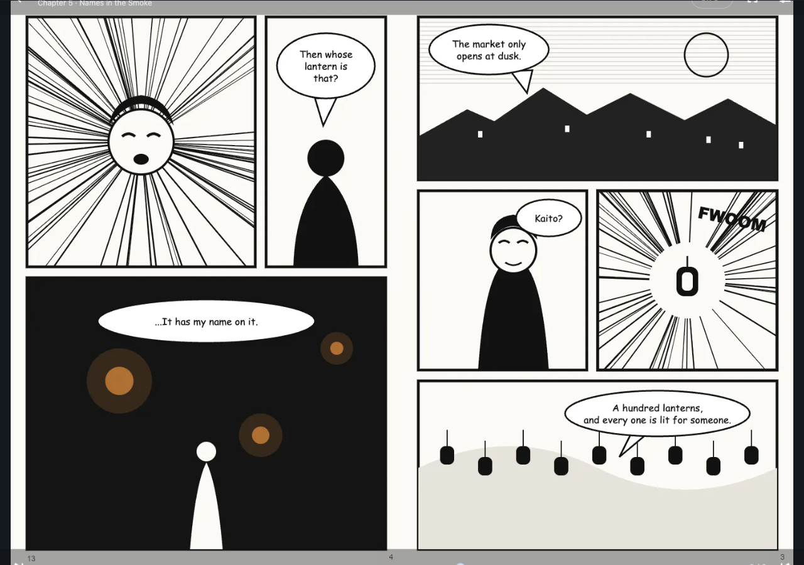
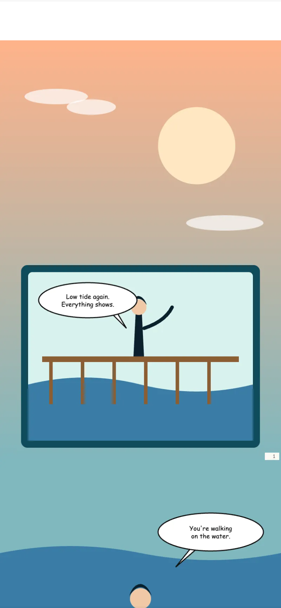
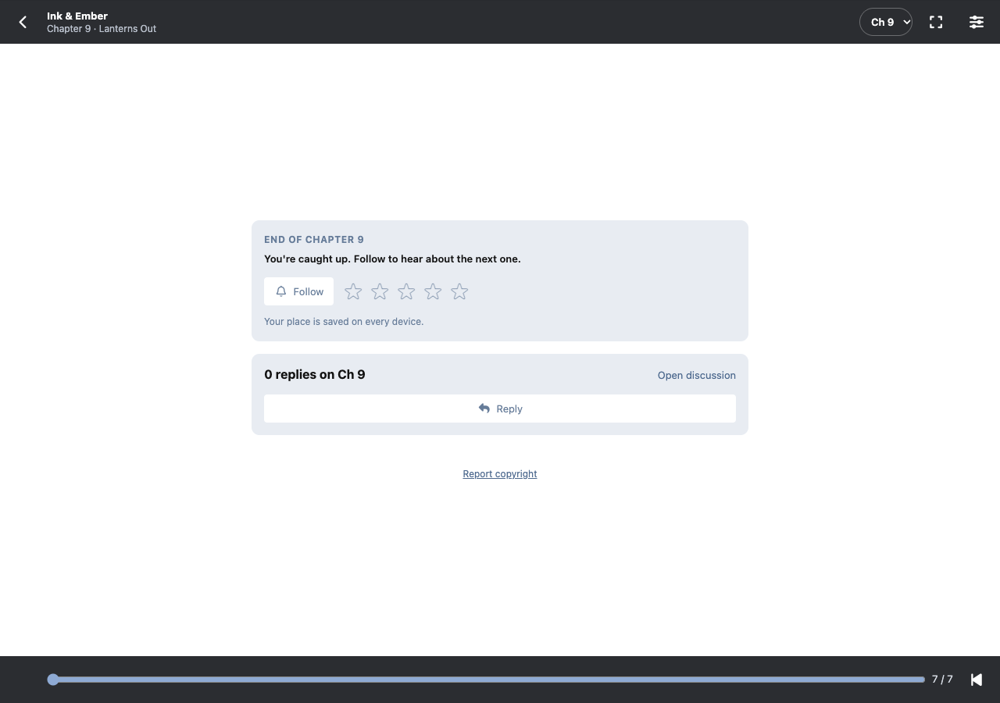
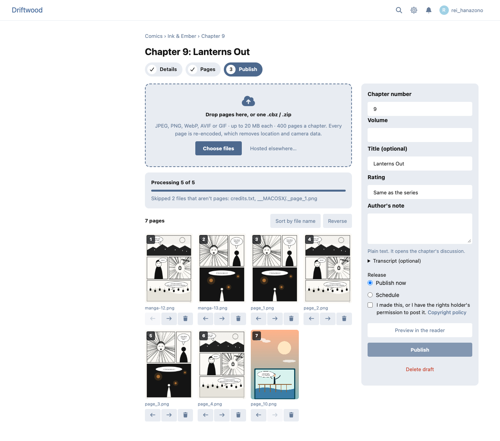
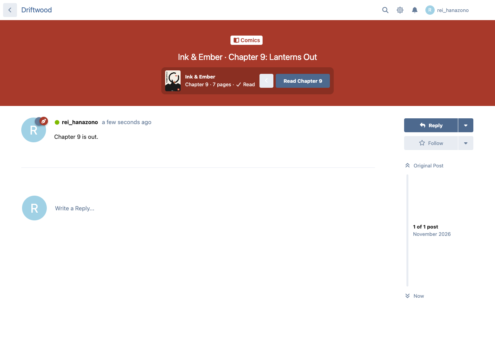
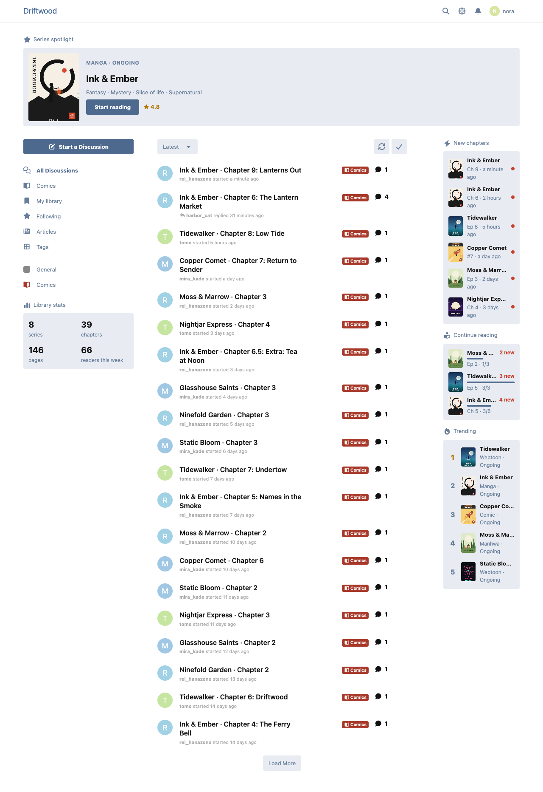

# Panels

A manga, webtoon and comics library and reader for Flarum 2.

- **Series** with a cover, other names, format (manga, manhwa, manhua, webtoon, comic), status, a content rating, genres and the details your forum asks for (author, artist, year…).
- **Chapters** from uploaded pages or one .cbz / .zip, or a link to where the chapter is officially hosted. Pages are re-encoded to WebP at 720, 1080 and 1600 px wide (which strips location and camera data), and very tall webtoon strips are cut into seamless segments.
- **A reader built for phones first**: a vertical strip for webtoons, page by page left to right, and right to left for manga, with two-page spreads on wide screens, keyboard, swipe and tap zones, Data saver, and your place saved on every device.
- **Libraries and follows**: Reading, Plan to read, On hold, Completed and Dropped shelves, "Continue reading", unread counts, and one notification per release.
- **A real discussion for every chapter**, in the tag you choose.
- **Age gating**: Mature series are blurred until a member confirms they're 18+. Explicit is off unless you turn it on.
- **Copyright**: a claim form anyone can file, a moderation queue, counter-notices, strikes for repeat uploaders, and a check that holds re-uploads of removed chapters.
- **Widgets** for FoF Widgets (and Bespoke's zones) and Page Builder: New chapters, Continue reading, Trending, Series spotlight and Library stats.
- Optional: **Kiosk** (paid chapters and series, early access), **Renown** (XP for publishing and finishing chapters), **Spoiler Shield** (chapter talk blurred past each member's place).

















All the series in these pictures are made up for the demo, with art drawn for it.

## Install

```sh
composer require ernestdefoe/panels
php flarum migrate
php flarum cache:clear
```

Then, in the admin: pick a tag for chapter discussions, grant "Start series and upload chapters" to a group (moderators have it by default), and fill in your copyright agent's details. Scheduled releases and notifications need Flarum's scheduler (`php flarum schedule:run` every minute); without it, they run at most once a minute when someone browses the library.

### nginx (optional)

Private pages (Mature, paid, scheduled) are sent by PHP. To let nginx send them instead, add an internal location and choose "nginx" in the settings:

```nginx
location /panels-private/ {
    internal;
    alias /path/to/flarum/storage/panels/;
}
```

## Update

```sh
composer update ernestdefoe/panels
php flarum migrate
php flarum cache:clear
```

MIT licensed. ☕ [Buy me a coffee](https://buymeacoffee.com/ernestdefoe)
